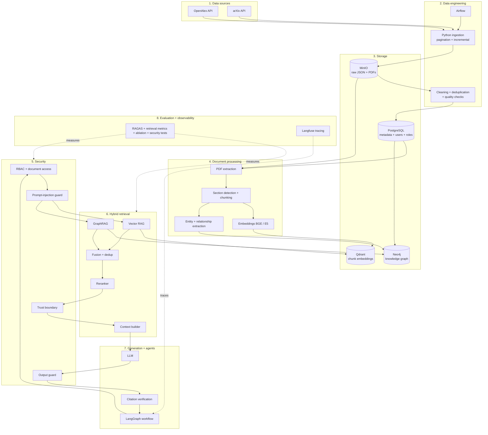

# 01 — System Architecture

Overall view of the platform. Every service runs in Docker Compose.

## Layers

1. **Data sources** — OpenAlex (papers, authors, institutions, topics, citations) and arXiv (abstracts, open-access full text).
2. **Data engineering** — Airflow schedules Python extractors that clean, deduplicate (DOI + source IDs) and validate.
3. **Storage** — MinIO keeps raw JSON and PDFs, PostgreSQL is the source of truth for metadata, users and roles, Qdrant stores chunk vectors, Neo4j stores relationships. `paper_id` links them.
4. **Document processing** — PDFs are extracted, split into sections and chunks, then embedded (Qdrant) and mined for entities (Neo4j).
5. **Security** — RBAC with document-level access, prompt-injection guard, trust boundary for retrieved text, output guard.
6. **Hybrid retrieval** — Vector RAG and GraphRAG run in parallel; results are fused, deduplicated, reranked and turned into a context.
7. **Generation + agents** — LangGraph orchestrates; the LLM answers; every claim is checked against retrieved evidence.
8. **Evaluation + observability** — retrieval metrics, RAGAS, ablation and security tests; Langfuse traces every run.
