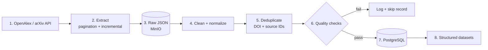

# 02 — Data Pipeline (offline)

How papers move from the APIs into PostgreSQL. Orchestrated by Airflow.

## Steps

1. **Source** — OpenAlex is the primary source; arXiv adds abstracts and open-access PDF links.
2. **Extract** — cursor pagination; incremental runs fetch only new or updated works.
3. **Raw JSON** — every response is stored untouched in MinIO so any later step can be replayed.
4. **Clean + normalize** — trim text, normalize DOIs, years, author names, rebuild abstracts from OpenAlex's inverted index.
5. **Deduplicate** — match on DOI first, then OpenAlex ID / arXiv ID, then normalized title.
6. **Quality checks** — required fields present, valid year range, non-empty abstract, no duplicate keys.
7. **Load** — upsert into PostgreSQL (`papers`, `authors`, `institutions`, `topics`, `paper_authors`, `paper_references`, `paper_topics`).
8. **Datasets** — SQL views / exports used by the next stages.
