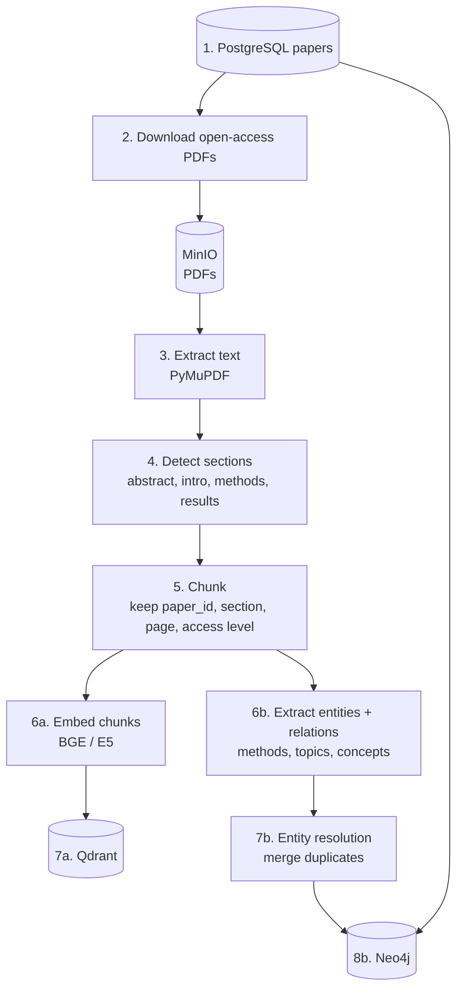

# 03 — Indexing Pipeline (offline)

How stored papers become searchable vectors and a knowledge graph.

## Steps

1. **Papers** — metadata, abstract and PDF URL come from PostgreSQL.
2. **Download** — only open-access PDFs, stored in MinIO; papers without a PDF stay indexed by abstract.
3. **Extract** — PyMuPDF text extraction, cleaned of headers, footers and references.
4. **Sections** — split by heading so retrieval can work at document → section → chunk level.
5. **Chunk** — fixed size with overlap; each chunk keeps `paper_id`, `section`, `page` and an access level for RBAC filtering.
6a. **Embed** — one vector per chunk.
7a. **Qdrant** — one point per chunk with its payload.
6b. **Extract** — LLM-based extraction of methods, concepts and relations from chunks.
7b. **Resolve** — merge variants of the same entity ("GraphRAG", "Graph RAG").
8b. **Neo4j** — Paper, Author, Institution, Topic, Method nodes with their relationships; paper–paper links come from PostgreSQL citations.
