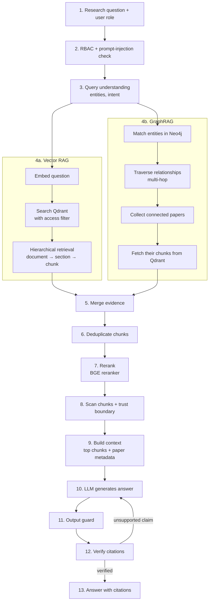

# 04 — Hybrid Retrieval Workflow (online)

Hybrid retrieval = **Vector RAG + GraphRAG**, run in parallel and fused. Security checks wrap the whole flow (see diagram 08).

## Steps

1. **Question** — the user's research question and role.
2. **Security in** — RBAC decides if the action is allowed; the input guard blocks injection attempts.
3. **Query understanding** — extract entities (papers, methods, topics) and the intent (find, compare, trace evolution).
4. **Parallel retrieval**
   - **4a. Vector RAG** — embed the question, search Qdrant with the role's access filter, retrieve hierarchically (papers, then sections, then chunks).
   - **4b. GraphRAG** — match entities in Neo4j, follow relationships (citations, shared methods, shared topics) for several hops, collect connected papers, then fetch their text chunks from Qdrant.
5. **Merge** — combine both evidence sets.
6. **Deduplicate** — the same chunk found by both paths is kept once.
7. **Rerank** — a cross-encoder reorders all candidates by relevance to the question.
8. **Scan + trust boundary** — drop chunks with hidden instructions; wrap the rest as untrusted data.
9. **Context** — keep the top chunks, tag each with `paper_id`, title, year and section.
10. **Generate** — the LLM answers only from the context.
11. **Output guard** — check for leakage and uncited claims.
12. **Verify** — every claim must map to a retrieved chunk; unsupported claims trigger a regeneration.
13. **Output** — answer plus citations.

Vector RAG finds *similar text*. GraphRAG finds *connected research*. Fusion gives both.
