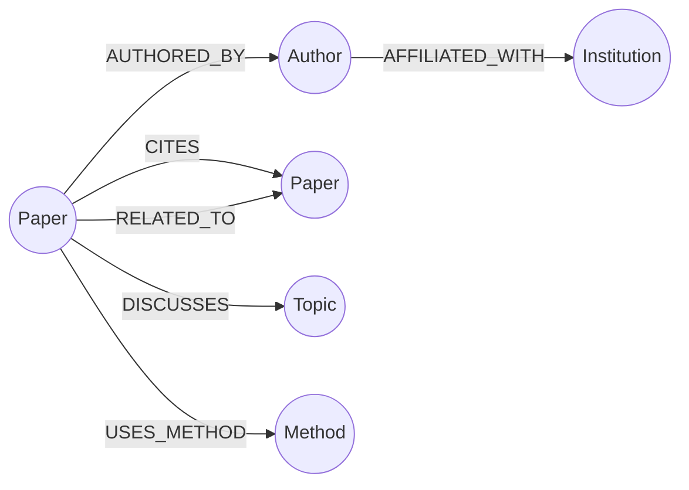

# 05 — Knowledge Graph Model (Neo4j)

## Nodes

| Node | Key properties |
|---|---|
| Paper | `paper_id`, `title`, `year`, `doi`, `cited_by_count` |
| Author | `author_id`, `name` |
| Institution | `institution_id`, `name`, `country` |
| Topic | `name`, `field` |
| Method | `name` |

## Relationships

| Relationship | Meaning | Source |
|---|---|---|
| `AUTHORED_BY` | paper written by author | OpenAlex |
| `AFFILIATED_WITH` | author belongs to institution | OpenAlex |
| `CITES` | paper cites paper | OpenAlex references |
| `DISCUSSES` | paper covers topic | OpenAlex topics |
| `USES_METHOD` | paper uses a method / technique | LLM extraction |
| `RELATED_TO` | similar papers | embedding similarity |

## Example multi-hop question

"Which methods are used by papers that cite the original GraphRAG paper?"
`(Paper {GraphRAG}) <-[:CITES]- (Paper) -[:USES_METHOD]-> (Method)`

The graph returns paper IDs; the text chunks for those papers are then fetched from Qdrant.
