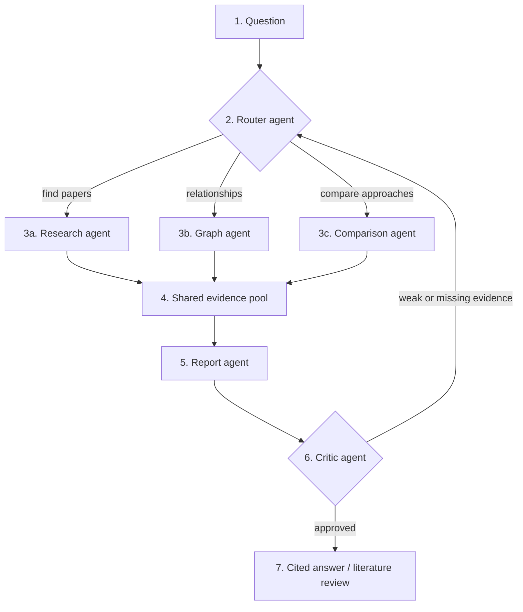

# 06 — Agent Workflow (LangGraph)

Agents are added only after hybrid retrieval works.

## Steps

1. **Question** enters the LangGraph state.
2. **Router** — classifies the question and chooses a retrieval strategy.
3. **Specialists**
   - **Research agent** — finds relevant papers (Vector RAG).
   - **Graph agent** — explores citations, authors, topics and methods (GraphRAG, multi-hop).
   - **Comparison agent** — compares methods and findings across papers.
4. **Evidence pool** — all retrieved evidence goes into one shared state, each item with its source.
5. **Report agent** — writes the answer or literature review with citations.
6. **Critic agent** — checks evidence coverage and citation support; sends the question back to the router if weak.
7. **Output** — the approved, cited result.

Loop limit: maximum 2 critic retries.
