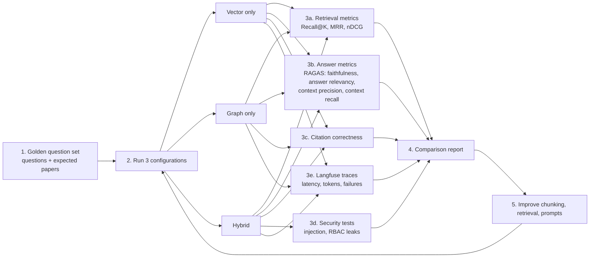

# 07 — Evaluation Workflow

## Steps

1. **Golden set** — 50+ questions with the papers that should be retrieved.
2. **Run** — the same questions through Vector-only, Graph-only and Hybrid.
3. **Measure**
   - **Retrieval metrics (custom)** — Recall@K, MRR, nDCG. Implement these yourself.
   - **RAGAS** — faithfulness, answer relevancy, context precision, context recall.
   - **Citation correctness** — share of cited claims supported by the cited chunk.
   - **Security tests** — injection payloads must be blocked; a `viewer` must never receive restricted documents.
   - **Langfuse** — latency, token cost, failures, per-step inputs and outputs.
4. **Report** — table comparing the three configurations.
5. **Improve** — adjust chunk size, top-K, reranker, prompts; run again.
6. **Regression** — a `pytest` suite keeps key questions and security cases from degrading.
