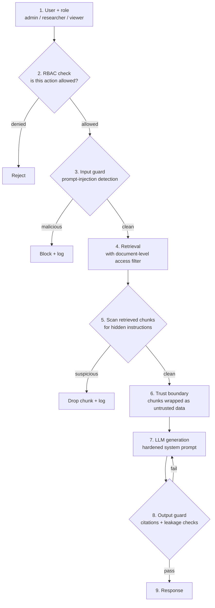

# 08 — Security Workflow (RAG + LLM)

## Steps

1. **User + role** — three roles: `admin`, `researcher`, `viewer`.
2. **RBAC** — each role has allowed actions (search, read paper, ask, compare, ingest, manage users).
3. **Input guard** — detect prompt-injection and jailbreak attempts in the question.
4. **Access-filtered retrieval** — Qdrant payload filters and Neo4j queries only return documents the role may see (document-level access control).
5. **Chunk scan** — retrieved text can contain hidden instructions (indirect prompt injection); suspicious chunks are dropped.
6. **Trust boundary** — remaining chunks are wrapped in delimiters and labelled untrusted: data, never instructions.
7. **Generation** — the system prompt states that only the question and the system prompt can give instructions.
8. **Output guard** — every claim needs a citation; no system-prompt or restricted-content leakage.
9. **Response** — answer with verified citations.
